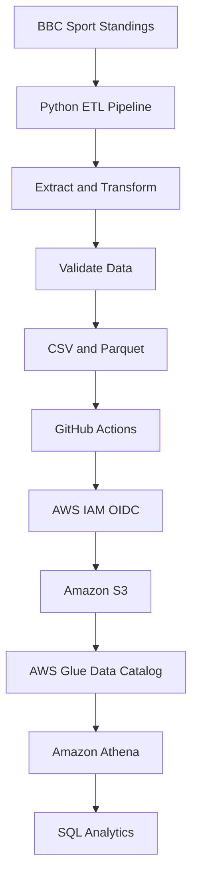

# Premier League Analytics — AWS ETL Pipeline

## Project Overview

An end-to-end data engineering project that extracts English Premier League standings, transforms and validates the data using Python and Pandas, stores the results in CSV and Parquet formats, and uploads the processed data to Amazon S3. AWS Glue catalogs the data, and Amazon Athena enables SQL-based analysis.

The pipeline runs automatically through GitHub Actions and uses AWS IAM OpenID Connect (OIDC) for authentication without storing long-lived AWS access keys in GitHub Actions.

## Architecture



## Technologies Used

- **Python:** ETL development
- **Requests and BeautifulSoup:** Web data extraction
- **Pandas:** Data transformation and validation
- **PyArrow:** Parquet file processing
- **Git and GitHub:** Source control
- **GitHub Actions:** CI/CD automation
- **AWS IAM OIDC:** Secure authentication from GitHub Actions to AWS
- **Amazon S3:** Data storage
- **AWS Glue:** Data catalog and table discovery
- **Amazon Athena:** SQL analytics

## Pipeline Workflow

1. Extract Premier League standings from the configured BBC Sport page.
2. Transform the extracted data into a structured Pandas DataFrame.
3. Validate the dataset.
4. Export the results to CSV and Parquet.
5. Run the ETL pipeline through GitHub Actions.
6. Authenticate to AWS using OIDC and an IAM role.
7. Upload the output files to Amazon S3.
8. Catalog the data with AWS Glue.
9. Query the Parquet dataset using Amazon Athena.

## Data Schema

The dataset contains these fields:

| Column | Description |
|---|---|
| position | League position |
| team | Team name |
| played | Matches played |
| won | Matches won |
| drawn | Matches drawn |
| lost | Matches lost |
| goals_for | Goals scored |
| goals_against | Goals conceded |
| goal_difference | Goals scored minus goals conceded |
| points | Total league points |

## Example Athena Queries

**1. Count the teams**

```sql
SELECT COUNT(*)
FROM premier_league_db.parquet;
```

**2. Display the top five teams**

```sql
SELECT position, team, played, won, points
FROM premier_league_db.parquet
ORDER BY position
LIMIT 5;
```

**3. Calculate goals scored and conceded**

```sql
SELECT
    team,
    goals_for,
    goals_against,
    goal_difference
FROM premier_league_db.parquet
ORDER BY goal_difference DESC;
```

## Local Setup

Prerequisites: Python 3.11 or a compatible Python version, Git, and pip.

Clone the repository:

```bash
git clone https://github.com/shashank030718/premier-league-analytics.git
cd premier-league-analytics
```

Create and activate a virtual environment on Windows:

```cmd
python -m venv venv
venv\Scripts\activate
```

Install dependencies and run the ETL pipeline:

```cmd
pip install -r requirements.txt
python src/main.py
```

The pipeline generates CSV and Parquet output files in the local `data/` directory.

## Security

GitHub Actions uses an AWS IAM role through OIDC. The role should have only the S3 permissions required for this project. AWS credentials should not be committed to the repository.

## Future Improvements

- Add automated data-quality tests.
- Schedule regular pipeline execution.
- Add CloudWatch monitoring and alerts.
- Create a Power BI dashboard using the processed data.
- Improve error handling and retry logic.

## What I Learned

- Building an ETL pipeline using Python and Pandas.
- Working with CSV and Parquet data formats.
- Automating pipeline execution with GitHub Actions.
- Configuring AWS IAM OIDC authentication.
- Storing data in Amazon S3.
- Cataloging datasets with AWS Glue.
- Performing analytical queries with Amazon Athena.

## Repository

[GitHub — Premier League Analytics](https://github.com/shashank030718/premier-league-analytics)
